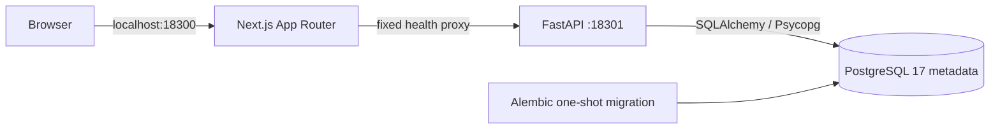

# Phase 2.1 architecture

ZeaOPS is a modular monorepo with a deliberately small runtime surface. No agent or privileged
infrastructure integration exists in this phase.

The web owns rendering and browser query state. TanStack Query polls health using abortable,
bounded, same-origin requests. React Hook Form and Zod validate the session-only refresh preference.
The shell uses shared owned shadcn/ui composition patterns (Radix Slot, CVA, utility merging),
Tailwind 4 tokens, cyan/violet accents, keyboard-visible focus, semantic landmarks, and mobile
navigation. Decorative topology is explicitly an architecture diagram, not traffic telemetry.
Reduced-motion preferences disable animations and transitions. No external font or imagery
request is necessary. Planned modules open descriptive views without management controls.

The web health proxy permits only `/api/health/live` and `/api/health/ready`. The upstream is
configured on the server at runtime, not compiled into the browser bundle. Incoming cookies and
authorization headers are not forwarded. There is no generic path proxy and no user-controlled
upstream. Redirects are refused, health bodies are size-bounded and runtime-validated, and
only known sanitized readiness failures are forwarded. Failed connections produce a safe 503 envelope with a correlation ID.

The API is created through an application factory. Typed Pydantic settings validate the database
driver, credentials, environment, and logging level. The SQLAlchemy 2 engine has bounded pools,
connect timeout, statement timeout, and parameter hiding. Database probes run in a worker without
blocking the event loop. The async readiness endpoint imposes a four-second HTTP deadline and
shares one in-flight probe per process, including during slow DNS failures, to bound worker use.
The lifespan waits a bounded time for the probe and always disposes the pool, including after
probe errors or lifespan failures.
Application startup does not require a healthy database: liveness stays available during outages.

Liveness checks the process. Readiness executes a real database probe and checks the initial
metadata table and expected Alembic revision. The single migration creates `bootstrap_metadata`
and Alembic's version record, without introducing speculative server, tenant, identity, or policy
schemas. Migrations are explicit; Compose gates the API on successful migration completion. The
API service builds the shared image once; the one-shot migration service reuses that image.

API application logs are JSON. Request logs include UTC timestamp, route template, method,
status, duration, and bounded correlation ID. Query strings, headers, bodies, database URLs,
and raw exceptions are excluded. A pure ASGI middleware preserves correlation context without
BaseHTTPMiddleware context propagation issues. Central handlers normalize HTTP, validation,
and unexpected application errors. TrustedHost rejects unexpected hosts at the framework edge.

Shared contracts are intentionally small: `packages/contracts` validates the health envelope and
preference, and `packages/api-client` turns API errors into typed client errors. Python response
models remain the backend authority. Unit and real connectivity tests guard their agreement;
OpenAPI code generation can replace manual contracts when the API grows.

Local Compose uses project-scoped storage, a bridge network, loopback ports, and no Docker socket.
PostgreSQL, web, and API run as unprivileged users with a read-only filesystem, dropped capabilities, no-new-privileges,
and bounded temporary filesystems. PostgreSQL uses its official entrypoint as UID 999 to initialize owned
storage. All services have CPU, memory, swap, process, and log rotation limits. Its development owner role is restricted to the isolated local instance; production role
separation has not been implemented. The web standalone output and API production dependency
environment use multi-stage builds. Web/API runtime containers exclude npm/yarn and pip installation
tooling, development tests, and development dependencies; the PostgreSQL image excludes unused gosu.
Debian package tools and metadata remain for OS inventory. Executable application files belong to root and are read-only to the
application users. Base images use pinned Debian 13 variants and current runtime security patches. Local container execution uses development API settings even though the web bundle
is optimized, preserving the separation between a build mode and a deployment environment.

CI installs locked dependencies, runs formatting/lint/typing/unit checks, starts isolated PostgreSQL,
applies migrations, checks schema drift, verifies actual browser/API/database connectivity, and
builds/runs the local container stack. It also verifies an independent fresh database, runtime
resource controls, source secrets, package advisories, and high/critical image advisories, including unfixed vendor advisories. The current strict image
gate is intentionally red; full audit results are retained for review. There is no release or deployment job. Exact package versions,
lockfiles, pinned base images, and immutable GitHub Action revisions make the inputs reviewable.

Future phases must define authentication, authorization, audit trails, secure server enrollment,
remote execution boundaries, credential storage, backup policy, and operational recovery before
exposing any privileged capability. No Phase 2.2 implementation is included.

Framework references: [Next.js App Router setup](https://nextjs.org/docs/app/getting-started/installation),
[Tailwind PostCSS integration](https://tailwindcss.com/docs/installation/using-postcss), and
[FastAPI typed settings](https://fastapi.tiangolo.com/advanced/settings/).

API images export production requirements from `uv.lock` and install them with mandatory hashes
using pip inside the builder, then remove pip before copying the virtual environment. This avoids
a stalled uv download path observed with Debian 13 while retaining the single canonical lock.
The pinned stable OS images receive an exact-version zlib security update; no unpinned upgrade
is applied. The PostgreSQL wrapper removes the unused root-only gosu binary.
